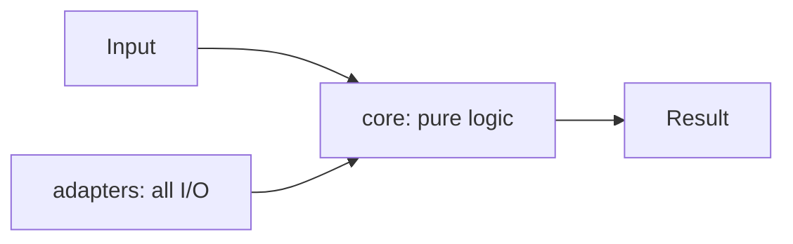

# Architecture

One diagram and a short explanation. Replace the placeholder below once M1 lands.

## Rules

- `core/` is pure logic: no network, no disk, no model calls. It never imports from `adapters/`.
- `adapters/` does all I/O and is passed into `core/`. That is what keeps unit tests and evals cheap.
- `cli.py` and `server.py` stay thin: parse, call `core/`, print. Logic that grows there moves to `core/`.
